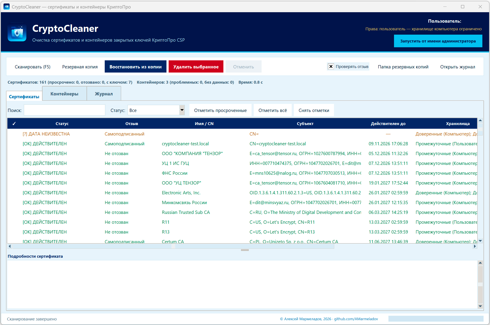

# CryptoCleaner

<p align="center">
  
</p>

<p align="center">
  
  
  
</p>

Очистка сертификатов и контейнеров закрытых ключей КриптоПро CSP в Windows.

Программа находит просроченные и действующие сертификаты в хранилищах
пользователя и компьютера, а также контейнеры закрытых ключей в реестре,
на жёстких дисках и USB-носителях. Отзыв сертификатов проверяется через
CryptoAPI (`CertVerifyRevocation`): статус «отозван» заявляется только при
подтверждении CRL/OCSP, а при недоступности проверки показывается
«неизвестно» — это никогда не считается действительным сертификатом.
Перед удалением программа предлагает резервную копию и **проверяет, что
все выбранные объекты действительно восстановимы**; если это не так,
удаление блокируется. После удаления результат **проверяется повторным
чтением** хранилища, каталога или ветки реестра. Ошибка доступа никогда не
считается успехом.

Поддерживаются Windows 7, 8, 8.1, 10, 11 и Windows Server 2012–2025.
Требуется Python 3.8 или новее (последняя версия с поддержкой Windows 7 —
Python 3.8). Внешние библиотеки не нужны: только стандартная библиотека
Python и Tkinter.

---

## Быстрый старт

1. Установите Python 3.8+ (при установке отметьте **Add Python to PATH**).
2. Запустите `run.bat` — откроется графический интерфейс.
3. Нажмите **Сканировать** (или F5).
4. Отметьте объекты галочками в таблицах.
5. Нажмите **Удалить выбранное** и следуйте подсказкам.

В заголовке окна показан текущий пользователь и его права. Если программа
запущена без прав администратора, кнопка **Запустить от имени администратора**
перезапускает её с повышением прав (появится запрос UAC).

Для удаления из хранилища компьютера (`LocalMachine`, ветка `HKLM`) и
контейнеров в `HKLM` нужны права администратора.

Консольный запуск:

```bat
run_console.bat --scan
```

---

## Скачать готовую сборку

- [Последний релиз](https://github.com/AMarmeladov/CryptoCleaner/releases/latest) — EXE и контрольная сумма.
- SHA-256 сборки 2.2.0: `068B2D26FF300FB205BAAD881AD133C31754013B6C6ECD6736E98D3529B5ABB3`.

EXE собран PyInstaller в один файл. Он не подписан, поэтому при первом запуске
Windows SmartScreen может показать предупреждение — это нормально для
неподписанных сборок.

---

## Полный функционал

Ниже — все возможности программы: инвентаризация сертификатов и контейнеров,
проверка отзыва, резервное копирование, восстановление, безопасное удаление,
графический интерфейс, консольный режим и диагностика.

- Сертификаты из шести хранилищ за один проход:
  - `My`, `CA`, `Root` для `CurrentUser`;
  - `My`, `CA`, `Root` для `LocalMachine`.
- Одинаковые сертификаты (совпадение SHA1-отпечатка) показываются одной
  строкой, но удаляются из **всех** хранилищ, где они найдены.
- Контейнеры закрытых ключей:
  - в реестре (`HKCU`/`HKLM`/`HKU`, 32- и 64-битные представления);
  - файловые на HDD и USB (`header.key` + `*.key`);
  - связывание контейнера с сертификатом по данным
    `certmgr -list -store` и серийному номеру тома.
- Три статуса для сертификатов и контейнеров:
  - `[X] ПРОСРОЧЕН`;
  - `[OK] ДЕЙСТВИТЕЛЕН`;
  - `[?] ДАТА НЕИЗВЕСТНА` / `[?] НЕТ ДАННЫХ`.
- Отдельный статус `[!] ОТОЗВАН` для сертификатов, отзыв которых подтверждён
  через `CertVerifyRevocation` (CRL/OCSP). Возможные значения столбца
  «Отзыв»:
  - `Не отозван` — проверка выполнена успешно;
  - `ОТОЗВАН` — CRL/OCSP подтвердили отзыв (с причиной, если известна);
  - `Неизвестно` — CRL/OCSP недоступны, проверка не выполнена или
    завершилась ошибкой. Это **не** «действителен»;
  - `Самоподписанный` — проверка не требуется;
  - `Не проверялся` — проверка отключена пользователем.
- Отдельный статус `[!] ОСИРОТЕВШИЙ` — контейнер без сертификата.
- Фильтры по статусу, типу и носителю, поиск по имени, субъекту, пути и
  отпечатку.
- Отдельный фильтр по издателю: **все издатели / Минцифры / Казначейство /
  прочие**. К УЦ Минцифры относятся также сертификаты Минкомсвязи и НУЦ
  России (`digital.gov.ru`, `minsvyaz.ru`), к Казначейству —
  `Федеральное казначейство` и `roskazna`.
- Сортировка сертификатов щелчком по заголовку любого столбца (повторный
  щелчок меняет направление, в заголовке показывается ▲ или ▼). Сортировка
  по издателю собирает вместе все сертификаты Минцифры, затем
  Казначейства, затем остальных.
- Быстрый выбор одним нажатием: кнопки **Минцифры** и **Казначейство**
  отмечают все сертификаты соответствующего издателя и сразу предлагают
  удалить их из системы.
- Путь реестрового контейнера отображается как `REGISTRY\<имя>`
  (ровно один обратный слэш).
- Журнал `INFO` / `OK` / `WARN` / `ERROR` рядом со скриптом; если папка
  недоступна для записи — в `%TEMP%`.
- Резервное копирование **в один файл** `*.ccbackup` (ZIP-архив) с
  сертификатами, контейнерами, настройками, `manifest.csv`, `objects.json`,
  `PASSWORD.txt` и `README.txt`.
- Восстановление из резервной копии с выбором отдельных сертификатов и
  контейнеров, включая старые резервные копии в виде каталога.
- Самопроверка после каждого удаления и восстановления; честный отчёт
  об ошибках.
- Корректное масштабирование при 100–300 % (per-monitor DPI v2): шрифты
  задаются в пикселях и не перекрывают соседние элементы.

---

## Графический интерфейс

### Вкладка «Сертификаты»

Колонки: отметка, статус, отзыв, имя/CN, **издатель**, субъект, срок
действия, хранилища, связанные контейнеры, отпечаток SHA1.

На панели инструментов есть флажок **Проверять отзыв**. Он включён по
умолчанию; при отключении сканирование не обращается к CRL/OCSP.

Кнопки:

- **Минцифры** — отметить все сертификаты, выпущенные УЦ Минцифры
  (включая Минкомсвязь и НУЦ России), и предложить удалить их;
- **Казначейство** — то же для сертификатов УЦ Федерального казначейства;
- **Просроченные** — отметить все просроченные сертификаты
  (с учётом текущего фильтра);
- **Все** — отметить все строки текущего фильтра;
- **Снять** — снять отметки.

Фильтр по статусу: все / просроченные / действительные / дата неизвестна /
с закрытым ключом / **отозванные**. Отдельный фильтр **Издатель**: все
издатели / Минцифры / Казначейство / прочие.

Щелчок по заголовку столбца сортирует таблицу; повторный щелчок меняет
направление. Рядом с названием столбца показывается ▲ (по возрастанию) или
▼ (по убыванию). Сортировка работает и по издателю.

Отметить строку можно щелчком по первому столбцу, двойным щелчком или
пробелом. `Ctrl+A` в таблице отмечает все строки фильтра.

### Вкладка «Контейнеры»

Колонки: отметка, статус, тип, носитель, имя, расположение, сертификат
(имя / CN), срок действия, отпечаток.

В колонке «Сертификат (имя / CN)» показывается имя сертификата из
хранилищ Windows — CN, понятное имя или субъект. Так видно, какому
сертификату принадлежит контейнер, а не просто факт «найден».

Фильтры:

- тип: все / реестр / файловые (HDD) / USB / неизвестные;
- статус: все / проблемные / просроченные / осиротевшие / действительные /
  дата неизвестна / нет данных.

Кнопка **Отметить проблемные** отмечает просроченные и осиротевшие
контейнеры.

### Вкладка «Журнал»

Все действия пишутся в файл и дублируются в окно. Кнопка
**Открыть файл журнала** открывает его в блокноте.

### Подробности

Внизу каждой вкладки показываются полные сведения о выбранной строке:
все хранилища, пути, ветка реестра, CSP-имя контейнера, примечания.

---

## Резервное копирование

Перед удалением программа **всегда** предлагает создать резервную копию:

- **Да** — создать копию и затем удалить;
- **Нет** — удалить без копии (потребуется дополнительное подтверждение);
- **Отмена** — ничего не делать.

Кнопка **Резервная копия** на панели инструментов создаёт копию отмеченных
объектов без удаления.

Сертификат считается сохранённым только при наличии файла `.cer` или PFX
с закрытым ключом. Контейнер считается сохранённым только тогда, когда
скопирован его каталог с `header.key`, экспортирована ветка реестра или PFX
действительно содержит закрытый ключ. Описание `.txt` само по себе успехом
не считается.

После упаковки программа **проверяет готовый файл копии**:

- ZIP читается заново, проверяется целостность;
- проверяются обязательные `objects.json`, `manifest.csv`, `PASSWORD.txt`,
  `README.txt`;
- для каждого сертификата проверяется наличие читаемого `.cer`, PFX с
  закрытым ключом или связанного контейнера с ключом;
- для каждого контейнера проверяется наличие `header.key`, `.reg` или PFX
  с закрытым ключом.

Если хотя бы один объект нельзя гарантированно восстановить, он попадает
в список «не восстановить», и **удаление блокируется**. При удалении
сертификата с закрытым ключом программа автоматически добавляет в копию
связанные с ним контейнеры, даже если вы не отмечали их для удаления, —
иначе ключ было бы невозможно восстановить.

Если вы всё же выбираете удаление **без резервной копии**, программа
требует ввести контрольное слово `УДАЛИТЬ`. Без точного ввода удаление
не начинается.

### Один файл вместо каталога

Резервная копия — это **один файл** `CryptoCleaner_Backup_ГГГГ-ММ-ДД_ЧЧ-ММ-СС.ccbackup`.
Это обычный ZIP-архив: его можно открыть 7-Zip, WinRAR или проводником
Windows. Внутри:

```
certificates/   .cer, .pfx и .txt с описанием
containers/     копии файловых контейнеров, PFX контейнеров
registry/       экспорт веток реестра .reg и настроек КриптоПро
manifest.csv    полный список объектов и путей (для Excel)
objects.json    служебные данные для точного восстановления
PASSWORD.txt    пароль для PFX (храните отдельно!)
README.txt      инструкция по восстановлению
log_copy.log    копия журнала
```

Каталог для копий выбирается автоматически:

1. папка `Backups` рядом с программой;
2. `Документы\CryptoCleaner_Backups`;
3. `%TEMP%\CryptoCleaner_Backups`.

Архив **не шифруется** средствами ZIP и содержит закрытые ключи, поэтому
хранить его нужно в защищённом месте.

### Восстановление в программе

1. Нажмите **Восстановить из копии** на панели инструментов.
2. Выберите файл `*.ccbackup` (или старую папку резервной копии).
3. В открывшемся окне отметьте нужные сертификаты. По умолчанию выбраны
   все сохранённые сертификаты; контейнеры отмечаются вручную.
4. При необходимости включите **Перезаписывать существующие контейнеры** —
   старые копии сохраняются рядом с суффиксом `.bak_ГГГГММДД_ЧЧММСС`.
5. Нажмите **Восстановить выбранное**.

После восстановления программа повторно читает хранилища, каталоги и ветки
реестра. Успех заявляется только при подтверждении; если проверить результат
не удалось (нет прав, носитель отключён), показывается ошибка.

### Восстановление вручную

- `.cer`: двойной щелчок → «Установить сертификат» либо
  `certutil -addstore -user My файл.cer`.
- `.pfx`: двойной щелчок → «Импорт» либо
  `certmgr -install -pfx -file файл.pfx -pin <пароль> -store uMy`.
- Если ключ КриптоПро **неэкспортируемый**, PFX содержит только сертификат
  без закрытого ключа. Восстановить такой ключ можно только из копии
  контейнера (`containers/`) или ветки реестра (`registry/`). Количество
  неэкспортированных ключей показывается в отчёте о резервной копии.
- Файловый контейнер: скопируйте каталог из `containers/` обратно по пути
  из `manifest.csv` (столбец «Путь»).
- Реестровый контейнер: импортируйте `.reg` из `registry/` (для `HKLM` —
  от администратора) и перезапустите КриптоПро CSP.

Старые резервные копии в виде каталога (`CertCleaner_Backup_*`) остаются
читаемыми: программа находит их по `manifest.csv`.

Подробная инструкция всегда создаётся в `README.txt` внутри копии.

---

## Консольный режим

```bat
:: только отчёт
python CryptoCleaner.py --scan

:: отчёт в JSON (удобно для автоматизации)
python CryptoCleaner.py --scan --json

:: отчёт без проверки отзыва (быстрее, без обращения к CRL/OCSP)
python CryptoCleaner.py --scan --no-revocation

:: удалить просроченные сертификаты и контейнеры (с подтверждением и копией)
python CryptoCleaner.py --delete-expired

:: удалить осиротевшие контейнеры
python CryptoCleaner.py --delete-orphans

:: без копии (потребуется ввести слово УДАЛИТЬ)
python CryptoCleaner.py --delete-expired --no-backup --yes
```

В JSON у каждого сертификата и контейнера есть поля `revocation`,
`revocation_reason` и `revocation_note`. У сертификатов также есть
`crl_urls` и `ocsp_urls` — адреса, по которым выполнялась проверка.
У контейнеров есть `cert_found` (сертификат найден в хранилищах) и
`cert_display` — имя сертификата (CN / понятное имя / субъект).
Значение `revocation`:
`good`, `revoked`, `unknown`, `self_signed` или `not_checked`.
Статус `unknown` никогда не считается «не отозван».

Коды завершения:

- `0` — успех (или нечего удалять);
- `1` — часть объектов удалить не удалось;
- `2` — резервная копия не подтверждена (есть ошибки или невосстановимые
  объекты), удаление остановлено;
- `130` — отменено пользователем.

---

## Проверка отзыва

Отзыв проверяется системным вызовом `CertVerifyRevocation` из `crypt32.dll`.
Для проверки используется DER-контекст сертификата, а издатель берётся из
уже перечисленных сертификатов по совпадению `issuer`/`subject`. Никакие
внешние утилиты (`certutil`, `certmgr`) для проверки отзыва не запускаются.

Возможные исходы:

- `good` — проверка выполнена, сертификат не отозван;
- `revoked` — CRL/OCSP подтвердили отзыв; причина показывается, если она
  есть в CRL;
- `unknown` — CRL/OCSP недоступны, точка проверки не найдена или проверка
  завершилась ошибкой;
- `self_signed` — издатель совпадает с субъектом, внешней проверки нет;
- `not_checked` — проверка отключена флажком или ключом `--no-revocation`.

`unknown` **не** приравнивается к `good`. В таблице и в JSON он так и
показывается — «Неизвестно».

Адреса проверки берутся из самих сертификатов — это расширения CDP
(CRL Distribution Points) и AIA (Authority Information Access). Они
показываются в подробностях сертификата и в JSON (`crl_urls`, `ocsp_urls`).
Например, встречаются `http://reestr-pki.ru/cdp/...`,
`http://cdp.tax.gov.ru/...`, `http://crl3.digicert.com/...`,
`http://www.microsoft.com/pkiops/...`. Внутренние адреса вроде
`crl.fk.local` или `c0000-app005` доступны только в сети организации —
если их нет, статус остаётся «Неизвестно».

Загруженные CRL/OCSP-ответы Windows кэширует сама; повторная проверка
обычно выполняется мгновенно. Внешние утилиты (`certutil`, `certmgr`) для
этого не используются.

---

## Как проверяется удаление

1. **Сертификат.** Перед удалением хранилище читается и проверяется наличие
   отпечатка. Удаление выполняется по очереди:
   `CertDeleteCertificateFromStore` → `certmgr -delete -store` →
   `certutil -delstore`. После каждой попытки хранилище читается снова.
   Успех — только если отпечатка больше нет и хранилище доступно для чтения.
   Если хранилище не открывается, результат помечается как неподтверждённый.
2. **Контейнер в реестре.** Ветка удаляется рекурсивно через
   `winreg.DeleteKeyEx`; при ошибке — `reg.exe delete /f` с нужным
   представлением реестра. Затем проверяется, что ветки нет. Если ветка
   не читается (нет прав или улей пользователя не загружен), результат
   считается неподтверждённым, а не успешным.
3. **Файловый контейнер.** Каталог удаляется через `shutil.rmtree`
   (снимается атрибут «только чтение»). Затем проверяется, что каталога нет.
   Если каталог занят, выполняется одна попытка через КриптоПро и повторная
   проверка. Если носитель отключён или каталог недоступен, результат
   считается неподтверждённым.
4. **Неизвестное расположение.** Удаление средствами КриптоПро может быть
   выполнено, но подтвердить его нечем — успех не заявляется.

---

## Ограничения и важные замечания

- Проверка отзыва требует доступности CRL/OCSP. В закрытых или офлайн-
  стендах проверка часто возвращает `CRYPT_E_REVOCATION_OFFLINE` или
  `CRYPT_E_NO_REVOCATION_CHECK`. В этом случае статус — **«Неизвестно»**,
  а не «действителен». Это сделано намеренно: программа не заявляет
  неподтверждённый результат.
- Проверка отзыва выполняется с таймаутом 3 секунды на сертификат и общим
  лимитом 40 секунд на сканирование. Результаты кэшируются в памяти на
  1 час; повторное сканирование не ждёт CRL/OCSP заново.
- Самоподписанные сертификаты не проверяются: у них нет внешнего CRL.
- Контейнер, защищённый PIN-кодом, может быть недоступен для чтения
  (`0x8009001a`). Такой контейнер всё равно находится в реестре или на
  диске и может быть удалён; его связь с сертификатом определяется по
  `certmgr -list -store`.
- `certmgr -list -container` для защищённых контейнеров может зависать,
  поэтому программа его не использует. Связи берутся из
  `certmgr -list -store`, а проверка — из `csptest -keyset -info`.
- `certutil -exportPFX` на ключах КриптоПро может зависать. Основной способ
  экспорта — `certmgr -export -store ... -pfx -dest ... -pin ...`; `certutil`
  используется только как резервный с коротким таймаутом.
- USB-контейнеры видны только при подключённом носителе. Буква диска может
  измениться — привязка выполняется по серийному номеру тома.
- Удаление сертификата не удаляет его закрытый ключ. Чтобы удалить ключ,
  отметьте соответствующий контейнер на вкладке «Контейнеры».
- Удаление контейнера, связанного с действующим сертификатом, делает
  восстановление подписи невозможным. Программа предупреждает об этом.
- Не запускайте удаление из хранилища компьютера без администратора:
  программа сообщит об ошибке, но ничего не повредит.
- Всегда проверяйте журнал и отчёт после операции.

---

## Файлы проекта

```
CryptoCleaner.py         точка входа (GUI и CLI)
run.bat                  запуск GUI без консоли
run_console.bat          запуск в консоли
build_exe.bat            сборка CryptoCleaner.exe через PyInstaller
README.md                этот файл
forgethub.jpg            скриншот главного окна для описания
dist/CryptoCleaner.exe   готовая сборка для Windows
cryptocleaner/
  __init__.py            версия пакета
  model.py               модели данных и статусы
  logger.py              журналирование
  winapi.py              CryptoAPI, проверка отзыва, DPI, текущий пользователь
  revocation.py          разбор CDP/AIA (адреса CRL и OCSP)
  tools.py               запуск certmgr/csptest/certutil/reg
  scanner.py             сканирование и сопоставление
  backup.py              резервное копирование в один файл
  restore.py             чтение копий и восстановление
  deleter.py             удаление с проверкой
  ui.py                  графический интерфейс
  assets/                иконка и логотип (ico, png)
script.ps1               исходная PowerShell-версия (для справки)
```

---

## Сборка EXE

```bat
build_exe.bat
```

Готовый файл появится в `dist\CryptoCleaner.exe`. Для сборки нужен
PyInstaller; остальные зависимости — стандартная библиотека Python.
Иконка EXE и окна берётся из `cryptocleaner\assets\cryptocleaner.ico`
и `cryptocleaner.png`; папка `assets` включается в сборку автоматически.

При запуске EXE журнал и резервные копии создаются рядом с EXE (если папка
доступна для записи), иначе — во временном каталоге.

---

## Диагностика

- **«certmgr.exe не найден»** — установите КриптоПро CSP или проверьте
  каталог `C:\Program Files\Crypto Pro\CSP`. Сертификаты Windows при этом
  всё равно доступны.
- **«Не удалось прочитать хранилище»** — закройте другие программы,
  работающие с сертификатами, и проверьте права.
- **Удаление из `LocalMachine` не удаётся** — запустите от администратора.
- **Контейнер «НЕТ ДАННЫХ»** — он защищён паролем или недоступен; это не
  ошибка программы.
- **Кнопка «Восстановить из копии» не находит файл** — выберите фильтр
  «Все файлы»: старые копии могли быть сохранены как каталог или `.zip`.
- **Нужен подробный разбор** — откройте журнал: в нём есть команды,
  коды возврата и вывод утилит.

---

## Безопасность

- Программа не удаляет ничего без явного подтверждения пользователя.
- Резервная копия предлагается всегда, даже при удалении одного объекта.
- Готовая резервная копия проверяется: если хотя бы один объект нельзя
  гарантированно восстановить, удаление блокируется.
- При удалении сертификата с закрытым ключом связанные контейнеры
  автоматически включаются в резервную копию.
- Удаление без резервной копии требует ввода контрольного слова `УДАЛИТЬ`.
- Перед удалением показываются предупреждения о действующих сертификатах,
  закрытых ключах и объектах хранилища компьютера.
- Резервная копия содержит закрытые ключи. Ограничьте доступ к файлу и
  удалите `PASSWORD.txt` из архива после восстановления.
- Архив не шифруется: пароль в `PASSWORD.txt` защищает только PFX-файлы,
  но не сам архив.

---

© Алексей Мармеладов, 2026 — <https://github.com/AMarmeladov>
